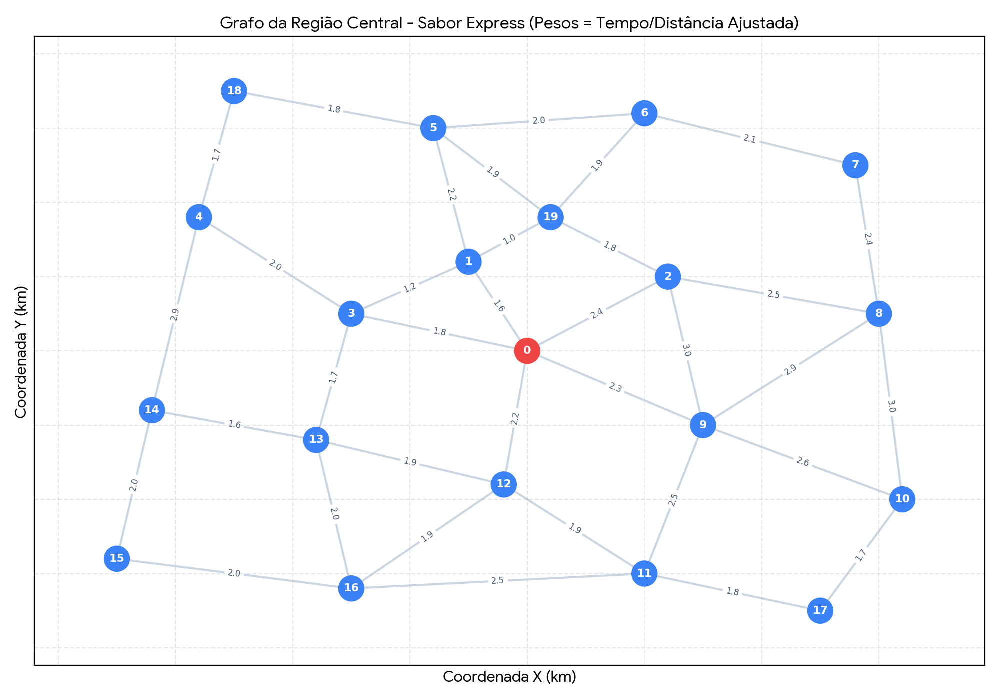
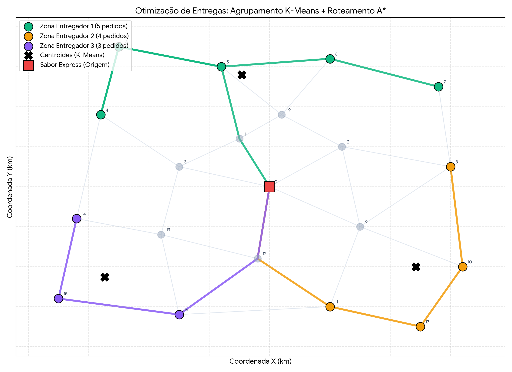

# Rota Inteligente: Otimização de Entregas com Algoritmos de IA

Projeto desenvolvido para a disciplina **Artificial Intelligence Fundamentals**, propondo uma arquitetura inteligente de roteamento e zoneamento de pedidos para a empresa de delivery **Sabor Express**.

---

## 1. Descrição do Problema e Objetivos

A **Sabor Express** é uma operação local de delivery de alimentos que atua na região central da cidade. Durante horários de pico (almoço e jantar), a definição manual de rotas baseada apenas na experiência dos entregadores gera:
- Atrasos nas entregas e queda na satisfação dos clientes;
- Cruzamento desnecessário de entregadores na mesma região;
- Aumento nos custos operacionais com combustível.

**Objetivo:** Desenvolver um pipeline de Inteligência Artificial Clássica capaz de agrupar pedidos próximos em zonas eficientes e calcular as rotas de menor custo (considerando distância e fator de tráfego) para cada entregador.

---

## 2. Abordagem Adotada e Modelagem do Problema

A cidade foi modelada como um **grafo não-direcionado ponderado** $G = (V, E)$:
- **Vértices ($V$):** 20 pontos estratégicos da região central (sendo o nó `0` a sede da *Sabor Express* e os nós `1` a `19` bairros/esquinas).
- **Arestas ($E$):** 35 vias conectando os pontos, cujo peso representa o **custo de deslocamento ajustado** ($	ext{Peso} = 	ext{Distância (km)} 	imes 	ext{Fator de Tráfego}$), simulando congestionamentos em avenidas centrais durante horários de pico.

A solução opera em **duas fases sequenciais**:
1. **Zoneamento (Clustering):** Divisão espacial dos pedidos ativos entre os entregadores disponíveis.
2. **Roteamento (Pathfinding):** Cálculo do menor caminho sequencial partindo do restaurante até todos os pontos da zona atribuída.

---

## 3. Algoritmos Utilizados

### 3.1. K-Means (Aprendizado Não Supervisionado)
Utilizado na **Fase 1** para agrupar as coordenadas $(x, y)$ dos pedidos em $K$ clusters (onde $K = 3$ entregadores). O algoritmo minimiza a variância intra-cluster (inércia), garantindo que cada motoboy atenda uma microrregião coesa.

### 3.2. Algoritmo A* (Busca Heurística Informada)
Utilizado na **Fase 2** para encontrar o caminho de menor custo entre pontos no grafo. A função de avaliação utilizada é:
$$f(n) = g(n) + h(n)$$
- $g(n)$: Custo real acumulado desde o nó de origem até o nó $n$.
- $h(n)$: Heurística baseada na **Distância Euclidiana** em linha reta até o destino. Como o fator de tráfego mínimo é $1.0$, $h(n)$ nunca superestima o custo real, garantindo **admissibilidade** e otimalidade do caminho encontrado.

### 3.3. Busca em Largura - BFS (Baseline de Comparação)
Implementada para fins de *benchmark*, demonstrando a diferença entre uma busca não informada (que ignora pesos de tráfego e guia direcional) e a busca heurística A*.

---

## 4. Diagrama do Grafo e Resultados Visuais

### Modelagem da Região Central


### Zoneamento (K-Means) e Rotas Otimizadas (A*)


---

## 5. Análise de Resultados, Limitações e Melhorias

### 5.1. Comparativo de Desempenho (12 Pedidos em Horário de Pico)

| Métrica | BFS + K-Means (Baseline) | A* + K-Means (Solução Proposta) | Impacto |
| :--- | :---: | :---: | :---: |
| **Custo Total Ponderado (Tempo/Dist.)** | 34.17 | **33.34** | **-2.4% de custo de trajeto (desvio de vias congestionadas)** |
| **Total de Nós Explorados na Busca** | 300 nós | **108 nós** | **-64.0% de esforço computacional** |

- **Eficiência:** O A* reduziu pela metade o número de estados explorados na memória em comparação ao BFS, além de desviar automaticamente de avenidas com alto `fator_trafego` (como a Av. Paulista Central).
- **Limitações:**
  1. O **K-Means padrão** não impõe restrição de capacidade máxima na mochila (*bag*) do entregador, podendo gerar clusters desbalanceados em dias atípicos.
  2. Os pesos de tráfego são estáticos por turno, não refletindo bloqueios repentinos em tempo real.
- **Sugestões de Melhoria:**
  1. Implementar **Constrained K-Means** (ou *VRP - Vehicle Routing Problem* com restrição de capacidade).
  2. Integrar dados dinâmicos via APIs de trânsito e aplicar **Aprendizado por Reforço (Reinforcement Learning)** para re-roteamento em tempo real, inspirado no sistema **ORION da UPS**.

---

## 6. Como Executar o Projeto

### Pré-requisitos
- Python 3.9 ou superior

### Passo a Passo
```bash
# 1. Clone o repositório
git clone https://github.com/seu-usuario/rota-inteligente-sabor-express.git
cd rota-inteligente-sabor-express

# 2. Instale as dependências
pip install -r requirements.txt

# 3. Execute o pipeline completo
python -m src.main
```
O terminal exibirá as rotas detalhadas por entregador, as métricas comparativas e atualizará automaticamente os gráficos na pasta `docs/`.
